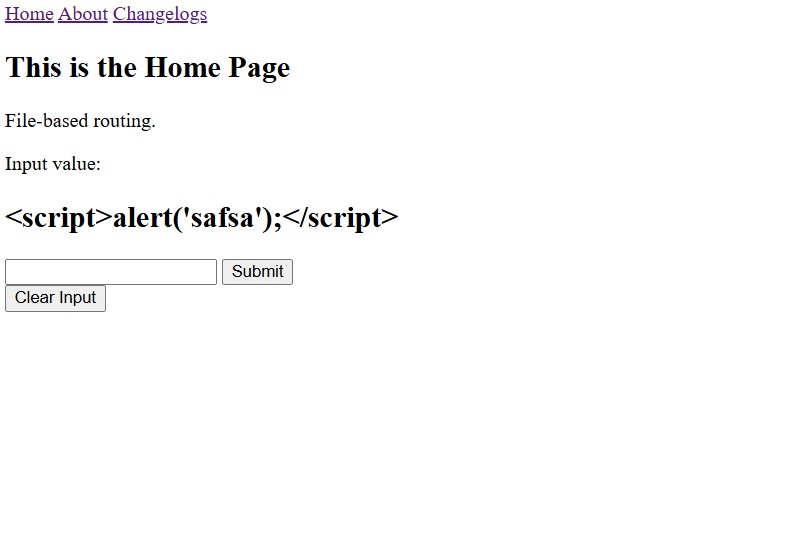

# PHP Demo

### Preview

### Prerequisites
- PHP
- Apache

*NOTE: Just use XAMPP to install the required prerequsites.*

---

### Setup:
1. Run `php -S localhost:[PORT]`. *NOTE: Make sure to add php.exe to your environmental variable in settings for php to be recognized as a valid command.*

---

### Concepts demonstrated:
- form-handling-demo
- post-request-demo
- conditional-rendering-demo
- php-routing-demo
- output-escaping-demo